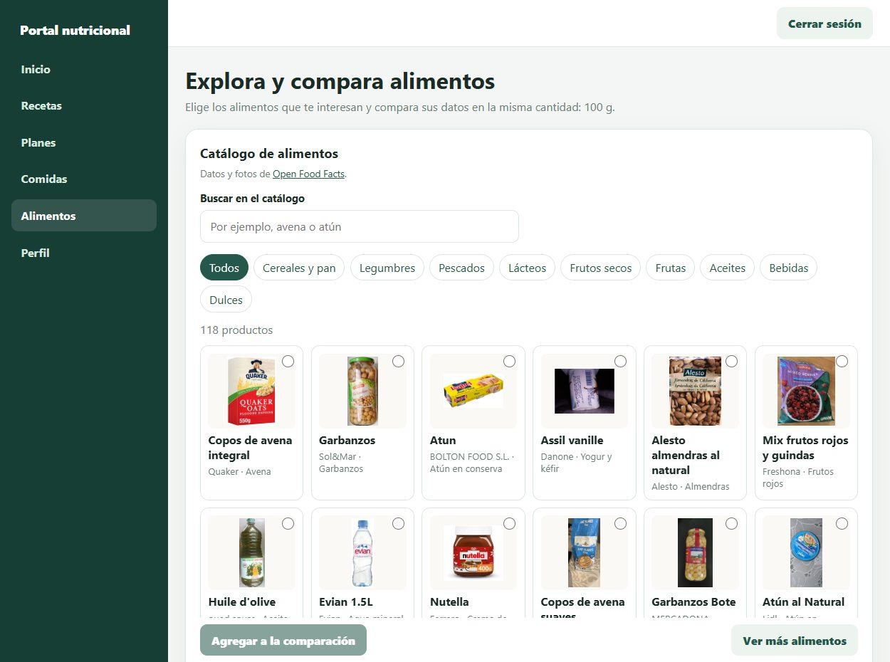
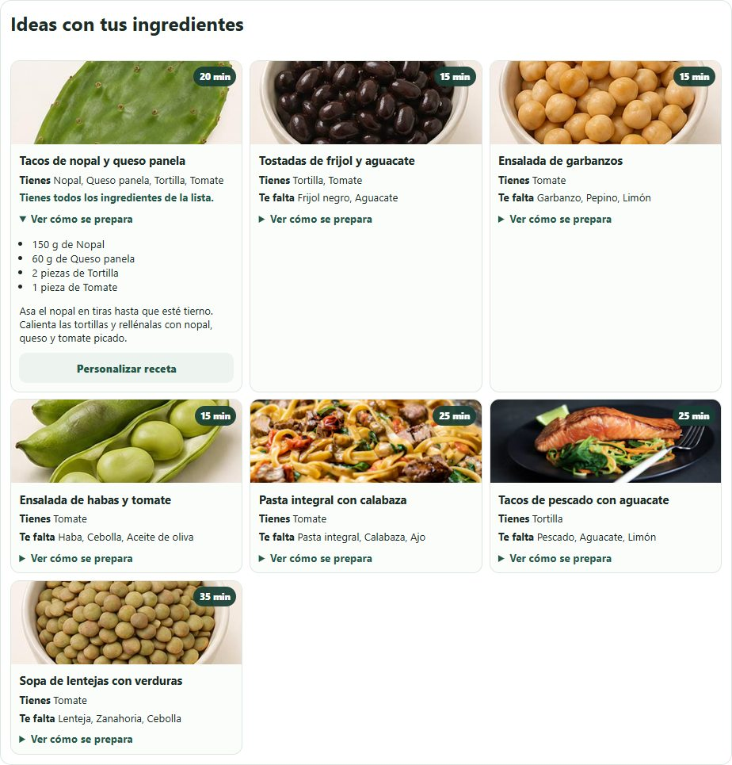
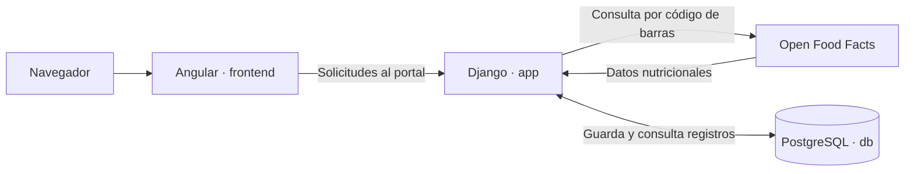

# Portal Nutricional

¿Qué puedes cocinar con lo que ya tienes en casa? ¿Cómo se comparan dos alimentos envasados? El Portal Nutricional reúne recetas, un catálogo con fotos y herramientas para organizar las comidas de la semana.

## Qué puedes hacer

| Sección | Para qué sirve |
| --- | --- |
| **Recetas** | Agrega ingredientes con un toque o arrástralos a la lista. El recomendador combina 20 ideas iniciales con tus recetas guardadas, prioriza las que necesitan menos ingredientes adicionales y te muestra cómo prepararlas. |
| **Alimentos** | Explora 118 productos en nueve categorías. Busca por nombre, marca o tipo de alimento y agrega productos a una comparación de energía, macronutrientes y azúcares por 100 g. |
| **Comidas y Planes** | Guarda comidas, selecciona las opciones para cada día de la semana y añade objetivos diarios si los necesitas. |



## Arranque rápido con Docker

Necesitas **Git**, **Docker con Compose** y conexión a Internet para la primera compilación y la importación de productos.

```powershell
git clone https://github.com/ErikFantomex/DjangoStore.git
cd DjangoStore
Copy-Item .env.example .env
```

Edita `.env` y reemplaza el correo de ejemplo en `OPEN_FOOD_FACTS_USER_AGENT` por uno de contacto. Después ejecuta:

```powershell
docker compose up --build -d
docker compose ps
```

Abre [el portal](http://localhost:4200), elige **Crear cuenta** e inicia sesión. La primera compilación puede tardar unos minutos. La documentación de la API está disponible en [Swagger](http://localhost:8000/api/docs/).

## Demostración en tres pasos

1. En **Recetas**, agrega nopal, queso panela, tortilla y tomate. Busca **Tacos de nopal y queso panela** entre las recomendaciones y abre **Ver cómo se prepara**.
2. En **Alimentos**, selecciona **Legumbres** y agrega dos productos con **Agregar a la comparación**. Revisa las gráficas y la tabla.
3. Recarga la página para comprobar que los productos siguen guardados. Vuelve a agregar el mismo producto para mostrar que se actualiza sin duplicarse.



## Cómo circulan los datos



Docker Compose ejecuta tres servicios: `frontend` muestra las recetas y las gráficas, `app` ejecuta Django y consulta Open Food Facts, y `db` conserva los datos de PostgreSQL en un volumen persistente. El catálogo inicial se filtra en el navegador. Al agregar un producto, Django consulta sus datos y guarda un registro por código de barras.

Consulta la [guía de la actividad](docs/PROTOTIPO_DATOS.md) para ver el esquema de datos, los comandos de verificación y el guion de exposición.

## Pruebas y cierre

```powershell
docker compose exec app python manage.py test
docker compose exec frontend npm run build
docker compose down
```

`docker compose down` detiene los servicios y conserva el volumen de PostgreSQL para el siguiente arranque.

## Licencia y datos

El código del proyecto se distribuye bajo la [GNU GPL v3](LICENSE). El catálogo, los datos nutricionales y las fotos de los empaques provienen de [Open Food Facts](https://openfoodfacts.github.io/documentation/docs/Product-Opener/api/). Algunas etiquetas pueden tener datos incompletos.
