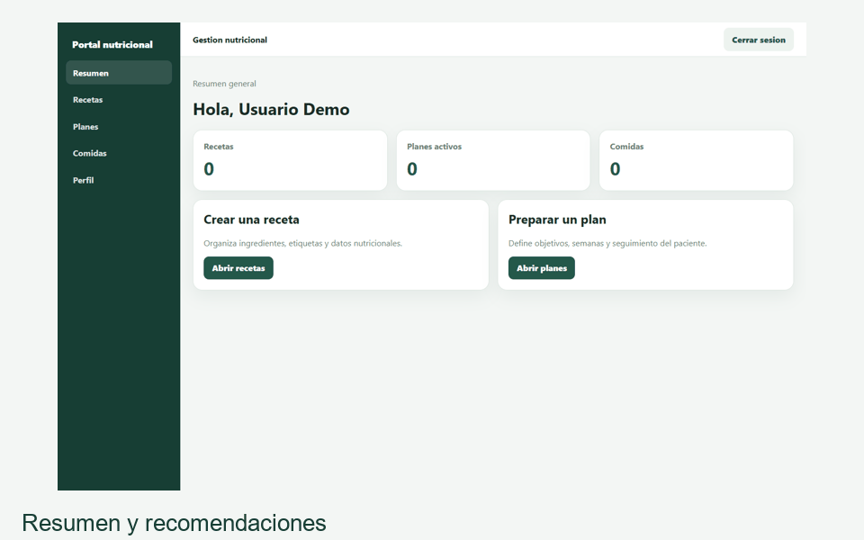
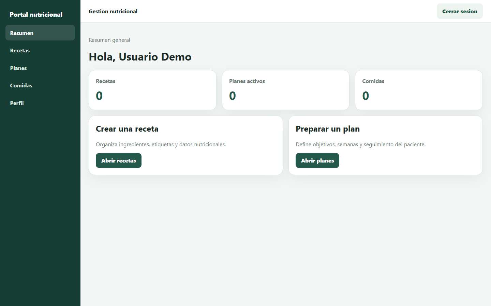
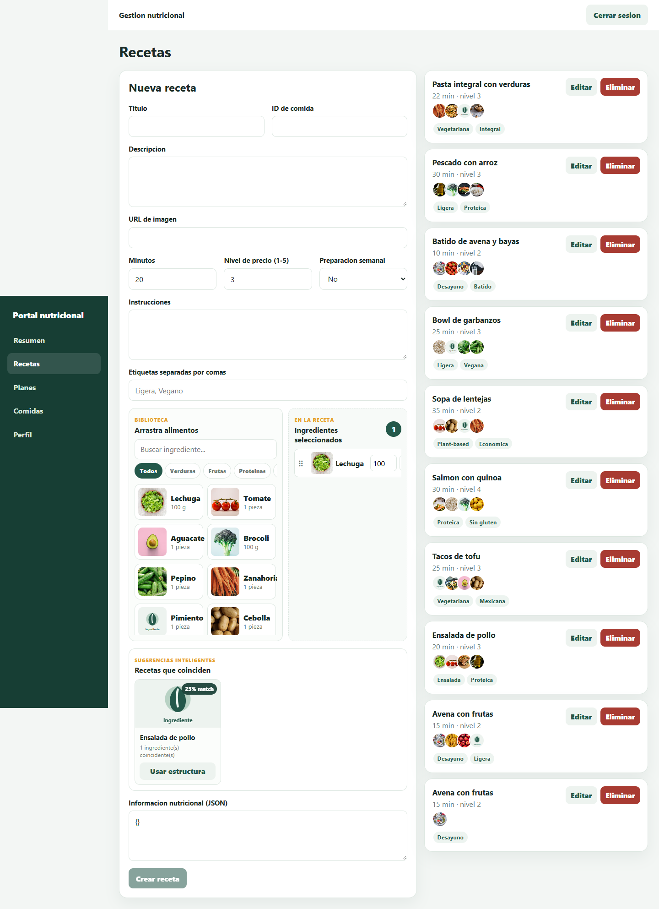
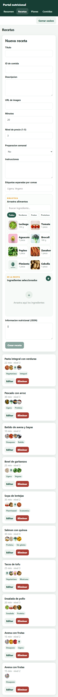

# 🍽️ Portal de Gestión Nutricional

**Prototipo Docker + API + base de datos + visualización:** consulta la [guía de la actividad](docs/PROTOTIPO_DATOS.md) para ejecutar y demostrar la integración de Open Food Facts con PostgreSQL y Angular.

Web App para Nutriólogos | Django

---

  

---

## 📖 Descripción

**Portal de Gestión Nutricional** es una aplicación web en Django que facilita a los nutriólogos la gestión de:

- ✅ **Planes de comida**: Crea, edita y guarda planes detallados para pacientes.  
- ✅ **Recetas**: Añade y modifica recetas con ingredientes, pasos de preparación y valores nutricionales.  
- ✅ **Serializadores**: Convierte modelos y querysets en JSON, XML u otros formatos de salida.

---

## 🚀 Características principales

| Funcionalidad             | Descripción                                                                 |
|---------------------------|-----------------------------------------------------------------------------|
| **Modelos & Serializadores** | Serializa datos complejos a formatos web-friendly.                   |
| **Gestión de Meal Plans**     | CRUD de planes de alimentación con recetas asociadas.              |
| **Gestión de Recetas**        | CRUD de recetas con ingredientes, instrucciones y macros.           |
| **Autenticación**             | Integrada con `django-allauth` para registro, login y social login.|

---

## ⚙️ Requisitos

- **Python** 3.x  
- **Django** (última versión estable)  
- **django-allauth** (para autenticación)

---

## 📦 Instalación y puesta en marcha

### Proyecto completo con Angular

```powershell
docker compose up --build
```

- Frontend Angular: `http://localhost:4200`
- Backend Django: `http://localhost:8000`
- Documentacion API: `http://localhost:8000/api/docs/`

El frontend consume el backend por el prefijo `/api` y usa autenticacion por token.

### Docker

```powershell
docker compose build
docker compose up -d
```

Crear superusuario:

```powershell
docker compose run --rm app sh -c "python manage.py createsuperuser"
```

Ejecutar migraciones y tests:

```powershell
docker compose run --rm app sh -c "python manage.py wait_for_db && python manage.py migrate"
docker compose run --rm app sh -c "python manage.py test"
```

Detener:

```powershell
docker compose down
```

### Desarrollo local

Sin `DB_HOST`, Django usa SQLite. Ejemplo:

```powershell
python -m venv .venv
.venv\Scripts\activate
pip install -r requirements.txt -r requirements.dev.txt
cd app
python manage.py migrate
python manage.py test
python manage.py runserver
```

---

## 🔧 Configuración adicional

En tu `settings.py`, añade el middleware de AllAuth:

```python
MIDDLEWARE = [
    # ... otros middlewares
    'allauth.account.middleware.AccountMiddleware',
    # ... otros middlewares
]
```

Y configura las apps de autenticación:

```python
INSTALLED_APPS = [
    # ... apps por defecto
    'django.contrib.sites',
    'allauth',
    'allauth.account',
    'allauth.socialaccount',
    # ... providers si los usas
]

SITE_ID = 1

AUTHENTICATION_BACKENDS = (
    "django.contrib.auth.backends.ModelBackend",
    "allauth.account.auth_backends.AuthenticationBackend",
)
```

---

## 📝 Uso

Una vez levantada la aplicación, accede a:

- **Dashboard Admin**: `http://localhost:8000/admin/`
- **backend de Nutriólogos**: `http://localhost:8000/`

---

## 🎬 Demostracion visual del proyecto MVP

La siguiente demostracion muestra el flujo principal: resumen del sistema,
constructor visual de recetas y adaptacion a dispositivos moviles.



### Dashboard y resumen

Vista general de las recetas, planes y comidas disponibles para el usuario.



### Composicion visual de recetas

Los ingredientes se presentan con imagen, cantidad y unidad. Pueden
seleccionarse por toque o arrastrarse al area de la receta. El sistema calcula
sugerencias segun los ingredientes elegidos.



### Experiencia responsive

La interfaz reorganiza el catalogo, el formulario y las listas para conservar
una experiencia util en tablets y celulares.



---

## 📄 Licencia

Este proyecto está bajo la licencia **MIT**. Revisa el archivo [LICENSE](LICENSE) para más detalles.

---
